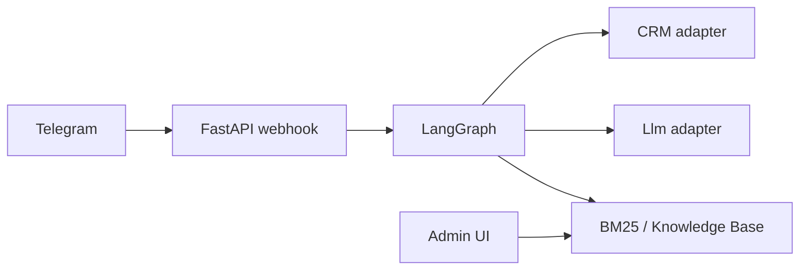

## 1. Business pain

Any private practice or service business runs several channels (messengers, on-site chat, social) with few admins. Inbound traffic is mixed: price questions, and in healthcare—fear about a procedure, “is this right for me?”, requests for empathy, support, and small talk. A good live admin can **support the person** and **not lose the booking funnel**. A bad outcome is either dry template replies or an overly “smart” chat that invents promises and leaves the manager without a structured lead card.

**What engineering must deliver:**

- **Speed and 24/7** on routine questions and agreed form fields (name, height, weight, conditions)—no medical conclusions or document requests.
- **One history per person** in the CRM (we used amoCRM): conversation and form fields in one place, not scattered chats.
- **Legally binding blocks** (consent, emergency paths)—answers verbatim from the knowledge base.
- **Calculations in code**, not in the LLM—in our case, body mass index.
- **Handoff**: after transfer to an admin, the bot produces a client card and context.
- **Personal data (152-FZ)**: mask sensitive fields in prompts, choose the LLM provider deliberately, no full name in model requests.

---

## 2. Why this is not “just GPT in Telegram”

A free-form agent with a system prompt like “you are a private-practice admin” fails predictably:

- hallucinations about procedures, quotas, prices;
- skipping consent before collecting personal data;
- losing the funnel after two small-talk turns;
- no way to explain to the client **why** the bot answered that way.

You need an **explicit decision graph**: what is deterministic code, what comes from the knowledge base, where the LLM only phrases an answer within context.

---

## 3. Architecture (short)

- **Python, FastAPI** — Telegram, CRM, LLM.
- **PostgreSQL** — knowledge base (“RAG” in our narrow sense) with BM25 search.
- **Adapters** — messengers, CRM, LLM.
- **LangGraph** — structure the dialogue, keep the funnel, still allow small talk.



---

## 4. LangGraph — the star of the show

LangGraph is an open-source framework for stateful AI applications.
It lets you model dialogue with an LLM not as a single chain but as multiple paths with steps, edges, and branches—switch topics, loops, retries.
LangGraph keeps shared context and data across steps, not just chat history.
You can pause a survey, resume at the right question, or roll back to any prior step.

That’s the point.

Routing looks like this:

```
START → guard → router → (rag | extract | small_talk) → form_filler → END
```

- **guard** — when the LLM should stop and call a human.
- **router** — how to handle the user message: knowledge-base hit, continue the form funnel, or small talk.
- **rag** — if the KB has an answer, weave it into the dialogue as a human would.
- **small_talk** — “What’s the weather in Philadelphia?” — a short supportive LLM line with **instructions to steer back to the consultation**.
- **extract** — otherwise, keep collecting form slots along the funnel.
- **form_filler** — next form step, consent, CTA.

Example in code (if anyone still cares):

```python
graph.add_node("guard", node_guard)
graph.add_node("router", node_router)
graph.add_node("extract", node_extract)
graph.add_node("rag", node_rag)
graph.add_node("small_talk", node_small_talk)
graph.add_node("form_filler", node_form_filler)

graph.add_edge(START, "guard")
graph.add_conditional_edges("guard", _after_guard, {"end": END, "router": "router"})
graph.add_conditional_edges(
    "router",
    _after_router,
    {"kb": "rag", "slot": "extract", "small_talk": "small_talk"},
)
graph.add_edge("rag", "form_filler")
graph.add_edge("small_talk", "form_filler")
graph.add_edge("extract", "form_filler")
graph.add_edge("form_filler", END)
```

---

## 5. RAG or knowledge base

I use “RAG” in a **narrow** sense: published knowledge base → search → generate with context.

1. Admins add articles **draft → publish**.
2. The user query is indexed with **BM25** and matched to prepared KB articles.
3. Weak matches are dropped.
4. The LLM (via an adapter, including Russian providers) gets only the retrieved context and a task to rephrase—no facts outside that context.

That way the bot **does not invent** clinical or pricing facts.

---

## 6. Determinism and compliance

| Risk | Mitigation |
|------|------------|
| Wrong BMI | Compute only in code, not in the LLM |
| Legal copy | KB articles with a “answer verbatim” flag |
| Personal data in LLM cloud | Masking in code |
| LLM invention | Explicit bans in the system prompt (our guardrails) |

---

## 7. amoCRM quirks

It’s one integration among many; I won’t dive deep, but two slippery points matter.

For many businesses amoCRM **is the world**—clients, data, conversations. The bot is only a proxy: inbound from the messenger and amo API client. It should stay invisible—no duplicate chats per client, no double replies from bot and admin, no broken thread in the amo UI.

---

## 8. Why custom, not a builder—if you read this far

No-code bots are fine for a pilot. Custom work pays off when you need a controlled form funnel, live small talk, and strict rules from the KB. That means forms, KB, legal wording that must not be distorted, and routing without calling the model. Which means—you need bespoke development.

---
