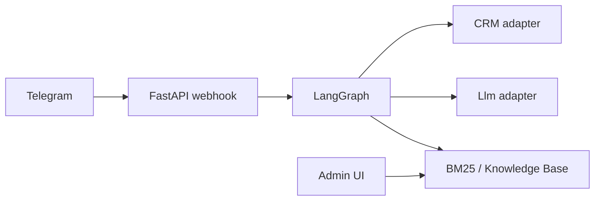

## 1. Боли бизнеса

Любая частная практика или сервис по предоставлению услуг – это несколько каналов (мессенджеры, чат на сайте, соцсети) и мало администраторов. Поток обращений смешанный: главное – цена услуги, если частная практика, то страхи и переживания по поводу операции, «а подойдёт ли мне?», запрос на эмпатию, поддержку, смол-толк. Живой, хороший администратор умеет **поддержать человека** и **не потерять воронку** записи на консультацию. Плохой сценарий – либо сухие шаблонные ответы, либо чрезмерно «умный чат», который придумывает и обещает лишнее, не оставляя менеджеру структурированную карточку.

**Что должна закрывать разработка:**

- **Скорость и режим 24/7** на типовых вопросах и сборе согласованных полей (ФИО, рост, вес, заболевания) — без выводов и запроса документов.
- **Единая история для человека** в CRM (в нашем случае это была amoCRM): хранение переписки и собранных по анкете полей, а не разрозненные чаты.
- **Юридически значимые блоки** (согласие, экстренные сценарии) – ответы дословно из базы данных.
- **Расчеты в коде**, не в LLM – в нашем случае требовался расчет индекса массы тела.
- **Handoff**: после передачи администратору бот формирует карточку о клиенте и контекст.
- **152-ФЗ**: маскирование чувствительных данных в промптах, осознанный выбор LLM-провайдера, без ФИО в запросе к модели.

---

## 2. Почему это не «просто GPT в Telegram»

Свободный агент с системным промптом «ты администратор частной практики» ломается предсказуемо:

- галлюцинации про процедуры, квоты, цены;
- пропуск согласия для сбора персданных;
- потеря воронки после двух реплик small talk;
- невозможность объяснить заказчику, **почему** бот ответил именно так.

Нужен **явный граф** решений: что детерминировано кодом, что – берется из БЗ, где LLM только формулирует ответ в рамках контекста.

---

## 3. Архитектура (кратко)

- **Python, FastAPI** — для общения с Telegram, CRM, LLM.
- **PostgreSQL** — база знаний (RAG по-нашему) с поиском BM25.
- **Адаптеры** — адаптеры интеграций с мессенджерами, с CRM, c LLM.
- **LangGraph** — чтоб структурировать общение, не потерять воронку, но поддержать small talk.



---

## 4. LangGraph – звезда всего представления

LangGraph – это фреймворк с открытым исходным кодом, предназначенный для построения сложных приложений с ИИ, управляемых состоянием.
С его помощью процесс диалога с LLM можно построить не как линейную цепочку, а в виде нескольких путей с шагами, связями и развилками. Это позволяет переключаться на другие темы диалога, реализовывать циклы и повторные попытки.
LangGraph сохраняет общий контекст и данные между всеми шагами выполнения, а не просто историю чата.
Он позволяет ставить опрос на паузу, продолжать с нужного вопроса или откатываться к любому предыдущему шагу. 

Красота!

Вот такая маршрутизация:

```
START → guard → router → (rag | extract | small_talk) → form_filler → END
```
где:
- **guard** – точка в диалоге, когда LLM должна принять решение и остановиться, чтоб позвать человека.
- **router** – как должно быть обработано сообщение пользователя: есть ответ в БЗ, или бот продолжает сбор данных для заполнения анкеты, или нужен смол-толк.
- **rag** — если есть ответ в БЗ, его нужно вписать в диалог, как словно бы человек отвечал.
- **small_talk** – «Какая погода в Филадельфии?» – хм... короткая поддерживающая реплика от LLM с **инструкцией вернуть диалог к консультации**.
- **extract** — если ничего из предыдущего не случилось, то надо продолжить сбор данных для анкеты по воронке.
- **form_filler** — следующий шаг анкеты, согласие, CTA.

Пример работы с LangGraph в коде (хотя кому это сейчас интересно):

```python
graph.add_node("guard", node_guard)
graph.add_node("router", node_router)
graph.add_node("extract", node_extract)
graph.add_node("rag", node_rag)
graph.add_node("small_talk", node_small_talk)
graph.add_node("form_filler", node_form_filler)

graph.add_edge(START, "guard")
graph.add_conditional_edges("guard", _after_guard, {"end": END, "router": "router"})
graph.add_conditional_edges(
    "router",
    _after_router,
    {"kb": "rag", "slot": "extract", "small_talk": "small_talk"},
)
graph.add_edge("rag", "form_filler")
graph.add_edge("small_talk", "form_filler")
graph.add_edge("extract", "form_filler")
graph.add_edge("form_filler", END)
```

---

## 5. RAG или база знаний

Я называю это RAG в **узком** смысле: опубликованная база знаний → поиск → генерация с контекстом.

1. Администратор вносит статьи в БЗ **черновик → публикация**.
2. Запрос пользователя индексируется по алгоритму **BM25** и сравнивается с так же подготовленными статьями в БЗ.
3. Слабые совпадения отсекаются.
4. LLM (через адаптер, в т.ч. для поддержки российских провайдеров) получает только найденный контекст и задачу перефразировать ответ, не выдумывая факты вне выданного контекста.

Так бот **не придумывает** клинические и ценовые факты.

---

## 6. Детерминизм и compliance

| Риск | Решение |
|------|---------|
| Неверный ИМТ | Расчет исключительно в коде, не в LLM |
| Юридические тексты | Статьи в БЗ с признаком «отвечать дословно» |
| ПерсДанные в облаке LLM | Маскирование в коде |
| Придумки LLM | Явные запреты в системном промпте (guardrails по нашему) |

---

## 7. Заморочки с amoCRM

Понятно, что это лишь одна интеграция и я не хочу погружать в детали, но на пару скользких моментов хотел бы обратить внимание. 

Для многих бизнесов amoCRM – **это целый мир**, там и клиенты, и их данные, и переписки с ними. Бот – лишь прокси, обработчик входящих из мессенджера и клиент API amo. Потому он должен оставаться незаметным, не плодить чаты, чтоб для одного клиента оставался один канал, чтоб ему не приходили двойные ответы от бота и от администратора, а история переписки не рвалась в интерфейсе amo.

---

## 8. Почему кастом, а не конструктор - спросите вы, если дочитали до сюда

No-code боты хороши для пилота. Кастомная разработка оправдана, когда нужны управляемый опрос по анкете, поддержка живого общения в виде small talk, а так же прямое следование правилам на основе информации из БЗ. Значит нам нужна анкета, БЗ, юридические формулировки, которые нельзя искажать и маршрутизация без вызова модели. Значит нам... вам... нужна заказная разработка.

---
